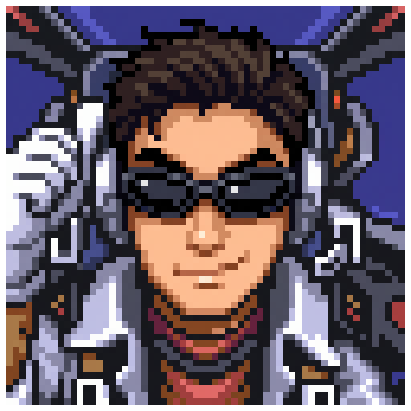
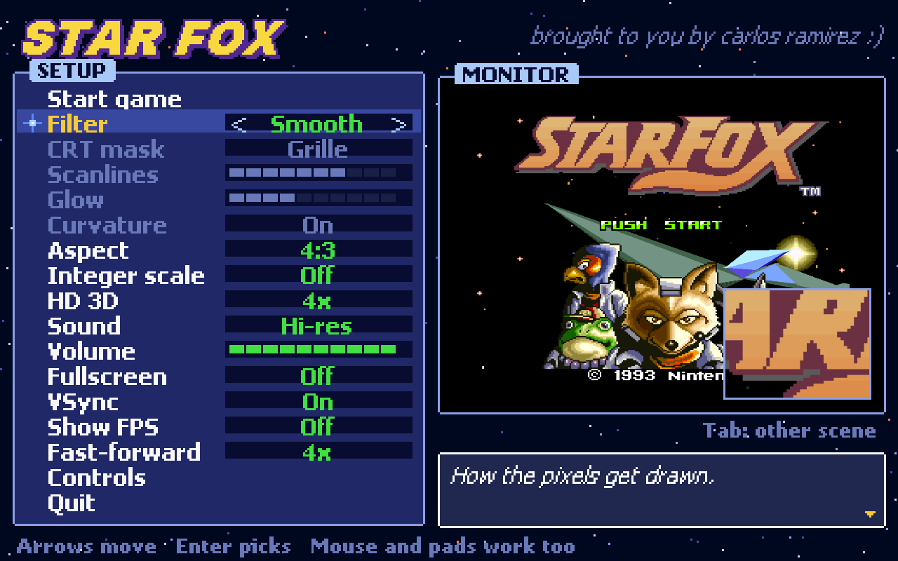
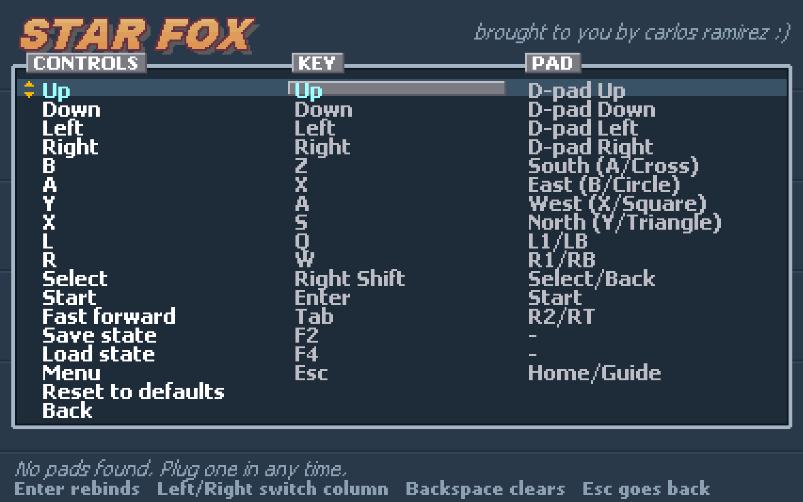
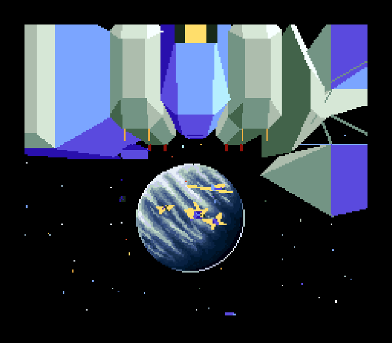
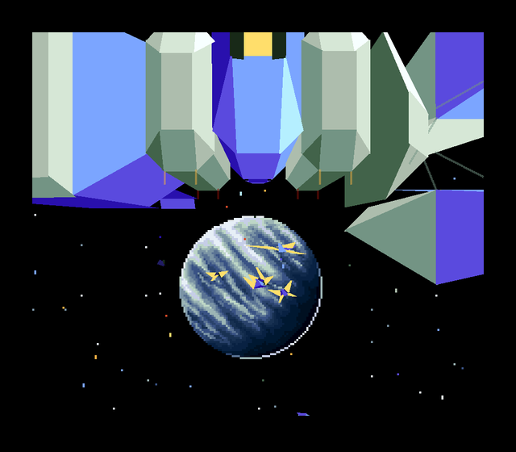
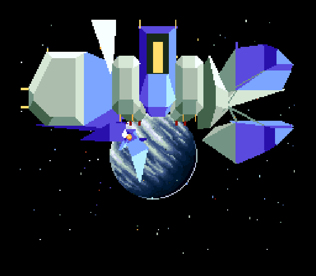
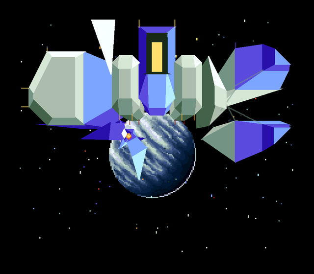
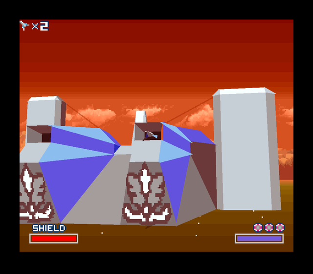
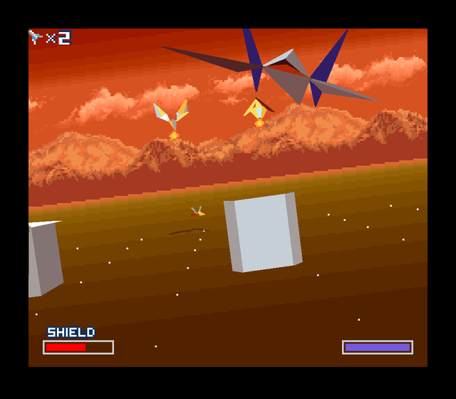
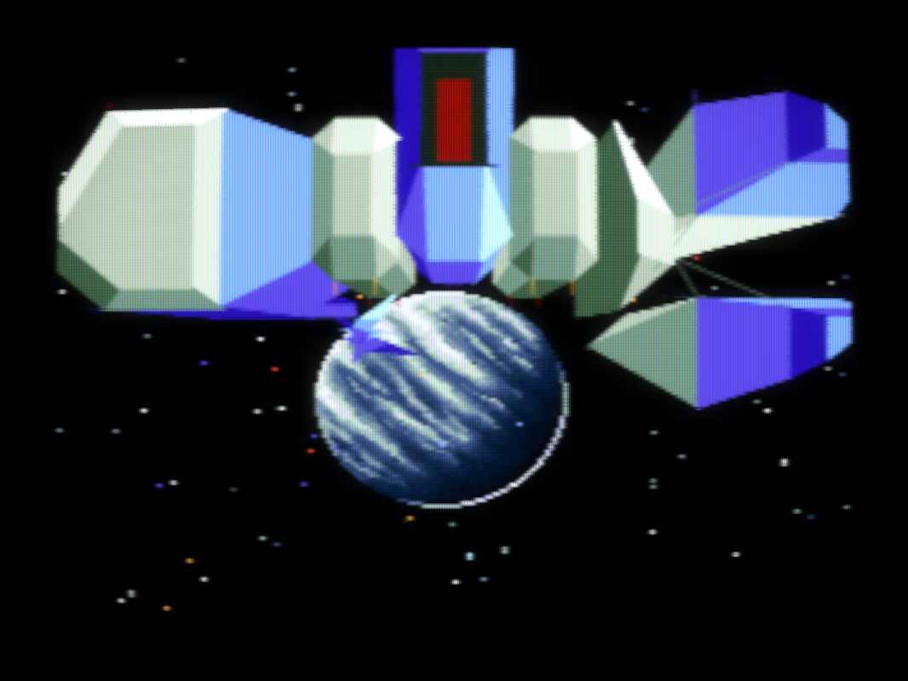

<p align="center"></p>

<h1 align="center">Project Arwing</h1>

<p align="center">
<b> Star Fox decomp / PC port with quality of life improvements </b>
<br>
Windows, macOS and Linux.
</p>

<p align="center">
<a href="https://github.com/carlosrmz009/arwing/actions/workflows/build.yml"></a>
<a href="https://github.com/carlosrmz009/arwing/releases/latest"></a>
</p>

---

* **Disassembly.** All 32 ROM banks in `asm/`: 65816 code, SuperFX code and data. It reassembles into a byte-identical ROM.
* **Static recompiler.** `tools/recomp.py` turns every 65816 and SuperFX instruction into C. No emulator loop for the bulk of the game.
* **Runtime.** PPU, SPC700 + S-DSP, SuperFX, DMA/HDMA and a 65816 interpreter fallback, written from scratch, plus a launcher with HD 3D, CRT filters and pad support.

> [!IMPORTANT]
> No game data is included. You need your own **Star Fox (USA) (Rev 2)** ROM
> (SHA-1 `cf08148cd8f26d51f8c67c956179dfc594e7a4f1`). Other revisions and regions are untested.
>
> Looking for Star Fox 2? That's [arwing2](https://github.com/carlosrmz009/arwing2).

## Screenshots

<p align="center"> </p>

<table>
<tr><th>OG SUPERFX</th><th>ARWING HD3D (4x)</th></tr>
<tr><td></td><td></td></tr>
<tr><td></td><td></td></tr>
<tr><td></td><td></td></tr>
<tr><td></td><td></td></tr>
</table>

<p align="center"><br><sub>CRT filter with HD 3D</sub></p>

## Play

Grab the file for your system from the [latest release](https://github.com/carlosrmz009/arwing/releases/latest):

| System | File | |
|---|---|---|
| Windows (x64) | `arwing.exe` | Run it to install. |
| macOS 11+ (Apple Silicon / Intel) | `arwing-macos.dmg` | Open it and run Project Arwing. Not notarized: the first time, right-click → Open (macOS 15: System Settings → Privacy & Security → Open Anyway). |
| Linux x86_64 | `arwing-linux.AppImage` | `chmod +x` it and run it. |
| Linux ARM64 | `arwing-linux-aarch64.AppImage` | Same. |

The installer adds shortcuts, then asks for your ROM once. A 512-byte copier header is fine, it gets stripped.
The launcher checks GitHub for a newer build and shows an update button when there is one.

Settings, saves and the copied ROM live in:

| | |
|---|---|
| Windows | `%APPDATA%\Project Arwing` |
| macOS | `~/Library/Application Support/Project Arwing` |
| Linux | `~/.local/share/project-arwing` |

Uninstalling keeps that folder. Windows: *Settings → Apps*. macOS: run the dmg again and pick Uninstall. Linux: the app menu entry has an Uninstall action, or run the AppImage again.

### Extras

The setup menu has a live preview. Esc, Home or Select+Start opens it in game.

| Option | |
|---|---|
| HD 3D | Off / 2x / 3x / 4x. Redraws the polygons at higher res. Sprites and textures stay 1x. Doesn't touch game state. |
| Filter | Sharp, Smooth, Scale4x, or CRT (grille/shadow/slot mask, scanlines, glow, curvature) |
| Aspect | 4:3, 8:7, 16:9 fill (blurred sides), 16:9 stretch. No true widescreen: the 3D view is a fixed-width bitmap. |
| Sound | Accurate (SNES filter) or Hi-res (no muffling, 48 kHz) |
| Misc | Integer scaling, fullscreen, VSync, FPS counter, volume, fast-forward speed |

### Controls

Remap anything under *Controls*. Xbox pads, DualShock 4 / DualSense, Switch Pro (Bluetooth) and most USB pads work, hot-plugged.

| Key | SNES | | Key | Action |
|---|---|---|---|---|
| Arrows | D-pad | | Tab | Fast-forward (hold) |
| Z / X | B / A | | F2 / F4 | Save / load state |
| A / S | Y / X | | F3 | Next state slot |
| Q / W | L / R | | P | Pause |
| Enter | Start | | F11, Alt+Enter | Fullscreen |
| Right Shift | Select | | F12 | Screenshot |

## Build

You still need the ROM: the big blobs (graphics, models, music) are extracted from it into `data/`.

**Windows:** Python 3.10+, Visual Studio 2022 Build Tools (MSVC x64).
**macOS:** Python 3, Xcode command line tools, SDL2.
**Linux:** Python 3, gcc, SDL2, FreeType, DejaVu fonts. Packaging the AppImage also needs `appimagetool`.

```bash
python tools/build.py path/to/starfox.sfc
```

That:

1. checks the ROM hash and extracts `data/*.bin` (headerless ROM only),
2. assembles `asm/starfox.s` into `build/starfox.sfc` and checks it matches the original,
3. recompiles everything into `build/gen/*.c`,
4. compiles `build/starfox.exe` (Windows) or `build/arwing` (macOS/Linux).

Run the binary from the repo root. Settings go to `starfox.ini`, states to `saves/`,
screenshots to `screenshots/`. The first launch spends ~10 s grabbing preview frames from the intro.

CI ([build.yml](.github/workflows/build.yml)) builds all four targets without a ROM: missing `data/` blobs are zero-filled,
which leaves the generated C unchanged. Every push to `main` refreshes the release.

<details>
<summary>Command-line options</summary>

| Option | |
|---|---|
| `--frames N` | run headless for N frames, then print a state summary |
| `--script FILE` | headless input: lines of `frame hexmask` (held from that frame on) |
| `--shot a,b,c` / `--shotprefix P` | save BMP screenshots at those frames |
| `--wav FILE` | record audio (headless) |
| `--hd N` | headless HD 3D at N× (screenshots get an extra `_hd.bmp`) |
| `--uitest PREFIX` | scripted walk through the launcher and game, saving the real OpenGL output |
| `--interp` / `--interp-gsu` | turn off recompiled code (CPU+GSU / GSU only) |
| `--hashlog FILE` | per-frame clock + WRAM hash, to compare recompiled vs interpreted runs |
| `--cov PREFIX` | record code coverage for the disassembler (forces the interpreter) |
| `--version` | print the version |

</details>

## How it works

1. **Coverage.** The runtime can log every executed 65816 instruction (with its M/X widths), every SuperFX
   instruction (with its ALT state), every indirect jump target, and where code in RAM was copied from. That
   settles the hard parts of 65816 disassembly (variable-length immediates, jump tables) and finds RAM-resident code.
2. **Disassembly.** `tools/disasm.py` claims what coverage proves is code, then extends it by recursive descent
   (branches, calls, pointer tables). Code the game copies to WRAM (`$7E:3193`, `$00:0101`) is
   assembled at its RAM address with `.base`. Everything else is data.
3. **Matching build.** `tools/asm.py` rebuilds the ROM; `tools/build.py` checks the hash.
4. **Recompilation.** Each basic block becomes a C function built from the same primitives the interpreter uses
   (`cpu_ops.h`, `gsu_ops.h`), so recompiled and interpreted runs are cycle-for-cycle identical. Every instruction
   is also an entry point, so execution can resume mid-block after an interrupt. Code in RAM only runs natively
   while its bytes still match the ROM; self-modifying code and anything the disassembly missed fall back to the interpreter.

## Status

| | |
|---|---|
| Matching ROM | yes, byte-identical |
| 65816 code | 34,472 instructions (~80 KB) |
| SuperFX code | 14,577 instructions (~18 KB) |
| Recompiled dispatches | 99.4 % CPU, 100 % SuperFX (20k frames of gameplay) |
| Recomp vs interpreter | identical per-frame hashes over 20k frames |
| Playable | intro, title, training, Corneria and other levels reached by random play |

Known gaps:

* Code discovery is coverage plus static analysis. Code never reached in the recorded sessions is still `.db`
  (it runs fine through the interpreter).
* Labels are auto-generated (`sub_`, `loc_`, `gsu_`, `tbl_`). The C is a mechanical translation, not hand-decompiled.
* Audio has only been checked indirectly (levels, spectrogram), not against hardware.
* HD 3D recovers sub-pixel positions for ~85–90 % of vertices (the main projection routine is hooked).
  The rest keep whole-pixel positions but still get clean edges. One alternate polygon path stays at 1x.
* One timing quirk is papered over: latching the PPU counters (`$2137`) also resets the `$213C`/`$213D` read flip-flops,
  because an interrupt can land between the game's two counter reads where the real console's timing never lets it.

## Contributing

Issues and PRs welcome. Useful things to work on:

* **Naming.** Pick a routine, figure out what it does, give it a real name. Biggest gap right now.
* **Coverage.** Play parts of the game that rarely come up and send the coverage files:
  ```bash
  build/starfox.exe --frames 40000 --script inputs.txt --cov out/cov1
  python tools/disasm.py path/to/starfox.sfc out/cov1 [out/cov2 ...]
  ```
* **Audio accuracy.** Compare against real hardware recordings.
* **HD 3D.** Hook the remaining projection routines in `src/hd.c`.

Before sending a change, check that `build/starfox.sfc` still matches the original hash and that the recompiled build
behaves exactly like the interpreter:

```bash
build/starfox.exe --frames 2000 --hashlog rc.txt build/starfox.sfc
build/starfox.exe --frames 2000 --hashlog interp.txt --interp build/starfox.sfc
fc rc.txt interp.txt
```

Never commit ROMs, `data/` or `build/`.

## Layout

```
asm/                 disassembly, bankXX.s per 32 KB bank, hw.inc register names
tools/
  disasm.py          coverage-seeded recursive-descent disassembler (65816 + GSU)
  asm.py             assembler; also writes build/ir.json for the recompiler
  recomp.py          IR -> C static recompiler (CPU and SuperFX)
  layout.py          ROM/RAM address map, RAM overlays
  isa65816.py        instruction tables
  isagsu.py
  extract.py         pulls data blobs out of your ROM
  build.py           full pipeline
src/
  cpu.c cpu_ops.h    65816 (ops shared with the recompiled code)
  gsu.c gsu_ops.h    SuperFX (ops shared with the recompiled code)
  ppu.c apu.c mem.c recomp_rt.c
  hd.c               HD SuperFX rendering
  app.c ui.c video.c config.c gfx.c romwiz.c update.c
  win32.c input.c    Windows front end
  sdl/               SDL front end (macOS + Linux)
  mac/ linux/        platform installers and text rendering
installer/           Windows installer (arwing.exe)
res/                 icons, logo, resources
```

## Thanks

* Nintendo and Argonaut Software for Star Fox.
* [SDL2](https://www.libsdl.org/), [FreeType](https://freetype.org/) and [DejaVu](https://dejavu-fonts.github.io/) (macOS/Linux builds).
* [zelda3](https://github.com/snesrev/zelda3), [sm64](https://github.com/n64decomp/sm64) and the other decomp projects for showing it can be done.

## License

[MIT](LICENSE) for the tools, runtime and installer. `asm/` is a disassembly of Nintendo's code and isn't covered;
neither is anything extracted from a ROM.

**Unofficial fan project and intellectual property notice**

This is an independent, unofficial software project. It is not affiliated with, endorsed by, or sponsored by Nintendo or SEGA.

Star Fox and all associated trademarks and copyrighted game content belong to their respective rights holders. Any gameplay screenshots included in this README are used to document and compare technical features of the software.

No original game ROMs or disc images are distributed with this project. Users must provide their own game copies.

This notice does not claim ownership of third-party intellectual property or imply permission to use it.

Not affiliated with or endorsed by Nintendo. Star Fox is a trademark of Nintendo.
